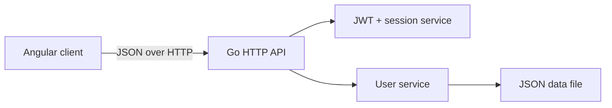

# Fraternity

> A compact full-stack user-management application built with Angular and Go.

Fraternity demonstrates a complete authentication flow: visitors can register,
sign in, view registered users, delete users, and sign out. The browser client
uses Angular and NgRx, while the Go API provides JWT authentication and
file-backed persistence with no database or Redis service required.

## Contents

- [Features](#features)
- [Technology](#technology)
- [Architecture](#architecture)
- [Quick start](#quick-start)
- [Configuration](#configuration)
- [Available commands](#available-commands)
- [API reference](#api-reference)
- [Authentication and persistence](#authentication-and-persistence)
- [Testing](#testing)
- [Troubleshooting](#troubleshooting)
- [Known limitations](#known-limitations)

## Features

- Register a user with name, email, and password
- Sign in and receive a short-lived JWT access token
- Protect application routes and API endpoints
- List registered users without exposing password data
- Delete users through an NgRx action/effect workflow
- Sign out and immediately revoke the active server-side session
- Persist user records to an atomically updated JSON file
- Track concurrent HTTP requests with a global loading indicator
- Display API feedback through toast notifications

## Technology

| Area | Technology |
| --- | --- |
| Web client | Angular 12, TypeScript 4.3, RxJS 6 |
| UI | Angular Material, Bootstrap styles, ngx-toastr |
| Client state | NgRx Store and Effects |
| API | Go standard library HTTP server |
| Authentication | HMAC-signed JWTs with in-memory session revocation |
| Password storage | bcrypt |
| Persistence | JSON file with locking and atomic replacement |
| Tests | Jasmine/Karma and Go's `testing` package |

## Architecture



The repository keeps the web and API code together while maintaining clear
boundaries inside each application:

```text
.
├── src/
│   ├── app/
│   │   ├── core/
│   │   │   ├── guards/         Route authorization
│   │   │   ├── interceptors/   JWT headers, loading state, and API errors
│   │   │   └── services/       Authentication, users, tokens, and loading
│   │   ├── home/               Authenticated user-list page
│   │   ├── login/              Login page
│   │   ├── register/           Registration page
│   │   ├── models/             Shared frontend types
│   │   └── store/users/        User actions, effects, reducer, and selectors
│   └── server/
│       ├── cmd/api/             API entry point
│       └── internal/
│           ├── auth/            JWT creation, validation, and revocation
│           ├── config/          Environment-based runtime configuration
│           ├── httpapi/         Routes, middleware, and handlers
│           └── user/            User domain and file-backed store
├── angular.json
├── package.json
└── serve.sh                     Starts the web client and API together
```

## Quick start

### Prerequisites

- Node.js 12.14+ and npm, as required by Angular 12
- Go 1.16+
- Chrome or Chromium only if you want to run the Karma browser tests

### 1. Install dependencies

```bash
npm run install-dependencies
```

This installs the npm packages and downloads the Go modules declared in
`src/server/go.mod`.

### 2. Start the application

```bash
npm start
```

| Service | Address |
| --- | --- |
| Web client | `http://localhost:4200` |
| API | `http://localhost:4201` |

The start script launches both processes and stops both when you press
<kbd>Ctrl</kbd>+<kbd>C</kbd>.

To run them in separate terminals instead:

```bash
npm run start:web
```

```bash
npm run start:api
```

### 3. Use the application

1. Open `http://localhost:4200/register`.
2. Create an account.
3. The client signs you in and redirects to `/home`.
4. View or delete users, then use **Sign out** to revoke the session.

## Configuration

The API reads configuration from environment variables. Every variable has a
local-development default, so no `.env` file is required to get started.

| Variable | Default | Purpose |
| --- | --- | --- |
| `PORT` | `4201` | API listening port |
| `DATA_FILE` | `<OS temp>/fraternity-users.json` | User data file |
| `JWT_SECRET` | Development-only fallback | HMAC signing secret |
| `ALLOWED_ORIGIN` | `http://localhost:4200` | Browser origin allowed by CORS |

Example with explicit local configuration:

```bash
JWT_SECRET='replace-with-a-long-random-value' \
DATA_FILE="$PWD/.local/fraternity-users.json" \
ALLOWED_ORIGIN='http://localhost:4200' \
npm run start:api
```

For a non-local deployment, always set `JWT_SECRET`, restrict
`ALLOWED_ORIGIN`, and store `DATA_FILE` on a private persistent volume. The
Angular API URL is configured in `src/environments/environment.ts` and
`src/environments/environment.prod.ts`.

## Available commands

| Command | Description |
| --- | --- |
| `npm start` | Start the Angular client and Go API together |
| `npm run start:web` | Start only the Angular development server |
| `npm run start:api` | Start only the Go API |
| `npm run build` | Create an optimized Angular production build in `dist/` |
| `npm run watch` | Rebuild the Angular client when files change |
| `npm test` | Start the Karma frontend test runner |
| `npm run test:api` | Run all Go tests |
| `npm run install-dependencies` | Install npm packages and download Go modules |

## API reference

The API accepts and returns JSON. Protected endpoints require this header:

```http
Authorization: Bearer <access-token>
```

| Method | Endpoint | Authentication | Description |
| --- | --- | --- | --- |
| `GET` | `/dummy-data` | No | Basic API availability check |
| `POST` | `/create-user` | No | Register a user |
| `POST` | `/login` | No | Authenticate and issue an access token |
| `GET` | `/show-users` | Yes | Return public user records |
| `POST` | `/delete` | Yes | Delete a user by ID |
| `GET` | `/logout` | Yes | Revoke the current session |

### Register

```bash
curl -i http://localhost:4201/create-user \
  -H 'Content-Type: application/json' \
  -d '{"name":"Ada Lovelace","email":"ada@example.com","password":"change-me"}'
```

### Login

```bash
curl -i http://localhost:4201/login \
  -H 'Content-Type: application/json' \
  -d '{"email":"ada@example.com","password":"change-me"}'
```

The login response contains an `access-token` and the public user record. Use
that token for protected requests:

```bash
curl http://localhost:4201/show-users \
  -H 'Authorization: Bearer <access-token>'
```

### Delete a user

```bash
curl -i http://localhost:4201/delete \
  -H 'Content-Type: application/json' \
  -H 'Authorization: Bearer <access-token>' \
  -d '{"id":1}'
```

Common API status codes include `201` for registration, `400` for malformed
input, `401` for invalid authentication, `404` for a missing user, and `409`
for a duplicate email address.

## Authentication and persistence

- Access tokens expire after 15 minutes.
- Active session IDs are kept in memory, allowing logout to revoke a token
  before its expiry time.
- Restarting the API clears session state and therefore signs out all clients.
- New passwords are stored as bcrypt hashes.
- API user responses contain only `id`, `name`, and `email`.
- File writes are protected by a mutex and use a temporary file plus atomic
  rename to avoid partially written JSON.
- User IDs increase from the highest existing ID, so deleting a user does not
  cause an existing ID to be reused.

## Testing

Run the backend suite:

```bash
npm run test:api
```

Run the frontend suite once in headless Chrome:

```bash
npm test -- --watch=false --browsers=ChromeHeadless
```

Create a production frontend build:

```bash
npm run build
```

If Karma cannot find Chrome, install Chrome/Chromium and set `CHROME_BIN` to
the browser executable before running the frontend tests.

## Troubleshooting

### Port already in use

Stop the process using ports `4200` or `4201`. To change the API port, set
`PORT`; remember to update the Angular environment URL to match.

### Browser requests are blocked by CORS

Set `ALLOWED_ORIGIN` to the exact origin serving the Angular client, including
its scheme and port.

### Existing sessions stop working after an API restart

This is expected: session revocation state is intentionally held in memory.
Sign in again to create a new session.

### Reset local user data

Stop the API and remove the file configured by `DATA_FILE`. If you did not set
it, the file is named `fraternity-users.json` inside your operating system's
temporary directory. A fresh empty store is created on the next startup.

## Known limitations

- JSON persistence is intended for local development and demonstrations, not
  concurrent multi-instance deployment.
- Session state is not shared across API processes.
- There is no refresh-token flow, pagination, role model, or account recovery.
- The production frontend API URL is still a build-time Angular setting.

Natural next steps include moving users and sessions to a database, adding
role-based authorization, introducing refresh-token rotation, and upgrading
the Angular toolchain.
